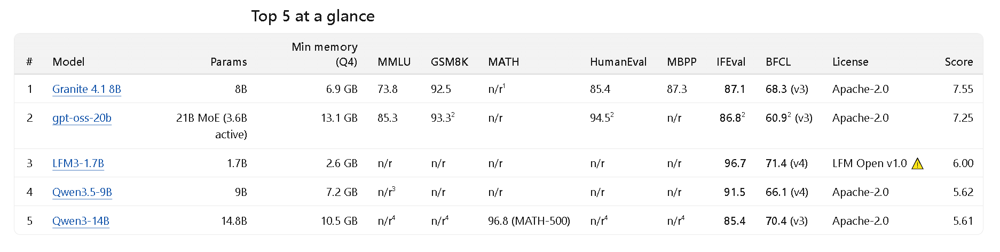

# slm-eval

A [Claude skill](https://docs.claude.com/en/docs/claude-code/skills) that finds the **5 best small language models (SLMs) to run locally** on your laptop or PC, based on what you need them for and how much memory you have.

Tell Claude what you want the SLM to do. It asks a few multiple-choice questions, researches the latest SLMs on Hugging Face and the leaderboards, and writes a report. For each model, the report gives **the minimum system requirements** and **the actual benchmark scores, with a source link for every number**.



*The at-a-glance table from a real run: SLMs for an AI commander in a PC RTS game, with 16 GB of memory and instruction-following and tool-calling set to High. [Read the full example report →](examples/example-report-rts-game-ai.md)*

---

## Install

### Claude Code (CLI, desktop app, IDE extensions)

Clone the repo into your personal skills folder.

macOS / Linux:

```bash
git clone https://github.com/adibenaroya1/slm-eval.git ~/.claude/skills/slm-eval
```

Windows (PowerShell):

```powershell
git clone https://github.com/adibenaroya1/slm-eval.git "$env:USERPROFILE\.claude\skills\slm-eval"
```

That's it. Claude Code finds the skill the next time a session starts.

- **Update:** `git -C ~/.claude/skills/slm-eval pull`
- **One project only:** clone it into `<your-project>/.claude/skills/slm-eval` instead.

### claude.ai

1. Download this repo as a ZIP (**Code → Download ZIP**).
2. In claude.ai, open **Settings → Capabilities → Skills** and upload the ZIP. If the upload rejects the folder name, rename the folder inside the ZIP from `slm-eval-main` to `slm-eval` and zip it again.
3. Make sure web search is turned on, since the skill researches live sources.

---

## Use

Type `slm-eval`, or just ask in your own words. Any of these work:

| You type... |
|---|
| `slm-eval` |
| `/slm-eval` (Claude Code slash command) |
| find me a SLM for summarizing my emails |
| which SLM should I run locally for coding? |
| recommend an SLM for my laptop |
| best SLM for 8GB RAM |
| compare SLMs for a chatbot in Hebrew |
| what SLM's can my PC run? |
| I need an SLM for my game / app / agent |
| evaluate SLMs for tool calling |
| help me choose an SLM that runs offline |

### What happens

1. **Context questions** (multiple choice):
   - what the SLM is for (skipped if you already said)
   - whether it must reply fast (real-time)
   - whether you'll use it commercially
   - how much memory it can use
2. **Benchmark questions.** For each of 7 benchmarks you pick **Low / Medium / High**. Each one is explained in plain words, and Claude marks the level it recommends for your use case.

   | Benchmark | In plain words |
   |---|---|
   | MMLU | A big multiple-choice quiz across 57 subjects: how much the model *knows* |
   | GSM8K | Grade-school math word problems: simple step-by-step reasoning |
   | MATH | Hard competition-level math |
   | HumanEval | Writes short Python functions that are checked by tests: basic coding |
   | MBPP | Like HumanEval, with more (easier) beginner tasks |
   | IFEval | Follows checkable rules ("under 50 words", "3 bullets"): does *exactly* what you asked |
   | BFCL | Calls the right tool/function with the right inputs: agent / tool use |
3. **Research.** Claude searches for current SLMs, using parallel agents when it can. Sources include model cards, technical reports, the official BFCL leaderboard, independent evaluations and GGUF repos.
4. **Filter and rank:**
   - Drops SLMs that don't fit your memory: Q4 file + 1.5 GB must be ≤ your limit.
   - Drops licenses that don't allow your use.
   - Ranks the rest by how well they meet your High and Medium needs.
5. **Report.** A Markdown file named `slm-report-<use-case>-<date>.md`. It contains:
   - a top-5 table
   - for each model: minimum and comfortable memory, download size, context length, thinking mode, CPU speed estimate and the command to run it
   - benchmark scores with sources
   - runners-up, excluded models (with reasons) and caveats

### How it keeps the numbers honest

- **Every score has a source link.** Missing scores show as `n/r` and are never guessed.
- **Base-model scores** are shown but not counted, since the model you run is the instruct version.
- **Benchmark variants are labeled.** That covers replacement benchmarks (MMLU-Redux, MATH-500 and others), thinking vs non-thinking mode, and which kind of BFCL score it is (the vendor's own run vs the official leaderboard). These scores don't compare directly, so each one is marked.
- **Questionable claims are flagged.** Vendor-only claims that look too good get a warning, and independent results win over vendor claims that they contradict.

---

## Requirements

- Claude with **web search / web fetch** tools. Claude Code has these built in; on claude.ai, turn on web search.
- Optional: subagents (Claude Code) for faster parallel research.

## Limitations

- Benchmarks are a filter, not the final answer. Before you commit, test the top 2–3 on your own prompts, for example with [promptfoo](https://www.promptfoo.dev/) + [Ollama](https://ollama.com). The skill offers to generate that config.
- Results are only as current as the sources at research time, and a run takes a few minutes of web research.
- Memory and speed figures are rules of thumb. Measure on your own machine.
